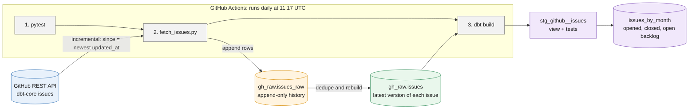

# GitHub Issues Sync

[](https://github.com/bcurran2/github-issues-sync/actions/workflows/sync.yml)

An incremental API-to-BigQuery integration. It pulls issues from a GitHub repository (dbt-labs/dbt-core by default), lands them in BigQuery, keeps a clean deduplicated table, and models monthly issue activity with dbt. A scheduled GitHub Actions workflow runs the whole thing daily.

## Pipeline



1. **Fetch.** Calls the GitHub issues endpoint with `state=all`, 100 per page, sorted by `updated_at`, following pagination links. Pull requests come back from the same endpoint, so they are filtered out.
2. **Land raw.** Each run appends rows to `issues_raw` with an explicit schema, a `_loaded_at` timestamp, and the full original JSON in a `payload` column.
3. **Deduplicate.** `issues` is rebuilt on each run, keeping the latest version of every issue by id using `ROW_NUMBER() OVER (PARTITION BY id ORDER BY updated_at DESC, _loaded_at DESC)`.
4. **Incremental loading.** The cursor is the newest `updated_at` already in the raw table. Each run asks GitHub only for issues updated since then, so a daily run fetches a few dozen issues, not the whole history.
5. **Model.** dbt builds a staging view and an `issues_by_month` table (CTEs plus a running-total window function for open backlog), with tests on both.
6. **Schedule.** A GitHub Actions workflow runs daily: tests, sync, dbt build.

## Design decisions

- **Inclusive cursor, deduplicated downstream.** GitHub's `since` parameter includes issues updated at exactly the cursor timestamp, so each run refetches a few already-loaded issues. In testing, a page-limited first load stopped partway through one second, and one issue sharing that timestamp was only picked up because the cursor is inclusive. A strict "after" cursor would have skipped it permanently. The dedupe step absorbs the overlap.
- **Append-only raw table.** Raw rows are never updated or deleted, so any load can be audited or replayed, and the clean table can always be rebuilt from it.
- **Rebuild instead of MERGE.** BigQuery's free sandbox blocks DML (`MERGE`, `UPDATE`, `DELETE`), and this project deliberately runs at no cost. A `CREATE OR REPLACE TABLE ... AS SELECT` rebuild does the same job. At larger scale, a `MERGE` on id would be the better choice.
- **Keyless cloud login.** The workflow authenticates to Google Cloud with Workload Identity Federation, so no service account key exists anywhere. The trust is restricted to specific repositories.
- **Reliability.** Requests retry with exponential backoff on network errors and 5xx responses, the script sleeps until reset when the GitHub rate limit is exhausted, and everything logs with timestamps and levels.

## Tests

Six pytest tests run with no network access, using fake API responses. They cover pull request filtering, pagination, retry on 503 then success, giving up after repeated network errors, sleeping when rate limited, and not sleeping when requests remain. The dbt models carry their own tests (unique and not-null keys, accepted values for state). The workflow runs both sets on every scheduled run.

## Run it yourself

Requires Python 3.12+, a Google Cloud project with BigQuery, and a GitHub token with read access to public repositories.

```bash
python -m venv .venv
source .venv/bin/activate
pip install -r requirements.txt
cp .env.example .env        # then fill in the values
gcloud auth application-default login
```

`.env` values: `GITHUB_TOKEN`, `TARGET_REPO` (for example `dbt-labs/dbt-core`), `GCP_PROJECT`, `BQ_DATASET`.

```bash
python src/fetch_issues.py --max-pages 1 --dry-run   # fetch a page, load nothing
python src/fetch_issues.py                           # incremental load
pytest                                               # unit tests
cd dbt && dbt build --profiles-dir .                 # models and tests
```

## Repository layout

```
src/fetch_issues.py              fetch, load, dedupe, cursor, retries, logging
tests/test_fetch_issues.py       mocked-API unit tests
dbt/models/staging/              source definition, staging view, tests
dbt/models/marts/                monthly issues mart, tests
.github/workflows/sync.yml       daily scheduled run
```

## Limitations

- The whole `issues` table is rebuilt on every run. That is fine at this size and would not be at much larger scale.
- Comments and timeline events are not loaded, only the issue records themselves.
- GitHub pauses scheduled workflows in repositories with no activity for 60 days, so the schedule may need a manual re-enable after a long quiet period.
